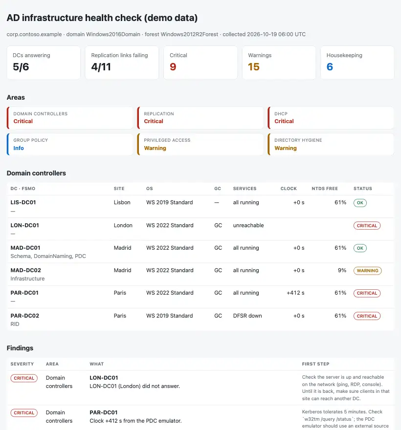

# AD Infrastructure Health Check

A weekly health check for **Active Directory and the core Windows services around it**: domain controllers, replication, DHCP, Group Policy and privileged access. One read-only PowerShell export, one Python command, and the answer to the Monday-morning question: **what is broken, what will break soon, and what is just untidy?**

Python 3.10+, standard library only. PowerShell export script (RSAT). Runs with fictional demo data out of the box.



## Why

`dcdiag` and `repadmin` tell you everything, one DC at a time, in a format nobody reads on a Monday. Most AD problems give a warning first: a clock drifting, a DFSR service stopped after patching, a replication link failing quietly for weeks, a DHCP scope at 96 % the week new joiners start, an admin account that nobody has used since spring.

This tool puts those signals in one page, ordered by what needs doing today, with the first step for each, and compares with last week so the meeting only talks about what changed.

## What it checks

| Area | Checks |
|---|---|
| Domain controllers | Reachable; NTDS, DNS, Netlogon, KDC, DFSR and W32Time running; SYSVOL and NETLOGON shared; clock offset (warning 60 s, critical 5 min); free space on the NTDS volume; FSMO role holders with a critical problem; sites without a Global Catalog. |
| Replication | Failing links (one finding per source → destination, partitions listed), warning if the last success is recent, critical after 24 h, critical when the link gets close to the tombstone lifetime. |
| DHCP | Scope usage (warning 85 %, critical 95 %), failover not in sync. |
| Group Policy | Empty GPOs, GPOs not linked anywhere. |
| Privileged access | Direct members of Domain/Enterprise/Schema Admins and Administrators: stale or never-used accounts, passwords that never expire, Schema Admins not empty, too many Domain Admins; krbtgt password age. |
| Directory hygiene | AD Recycle Bin off, old functional levels, inactive users and computers, client IP ranges with no AD site (NO_CLIENT_SITE in netlogon.log). |

An unreachable DC produces one finding, not ten: its services, clock and disk are not reported until it answers again.

Outputs: `report.html` (single file, light and dark mode), `findings.csv` (one row per finding with the first step) and `health_check.md` (Fix today / Plan this week / Housekeeping, ready to paste into the meeting notes).

How to run it every week: [docs/weekly-check-runbook.md](docs/weekly-check-runbook.md).

## Try it

```bash
git clone https://github.com/inigogonzalezgarcia/19-ad-infra-health-check.git
cd 19-ad-infra-health-check
python -m adhealth demo
```

Open `output/report.html` and `output/health_check.md`.

The demo is a made-up domain (`corp.contoso.example`) with six DCs in Madrid, Paris, Lisbon and London on a Monday at 06:00 UTC. Faults are placed on purpose: a London DC switched off after an office move, a Paris DC with DFSR stopped (and holding the RID master), a clock seven minutes ahead, a DC with 9 % disk left, a DNS partition that has not replicated for 97 days, a Lisbon site with no Global Catalog, a user DHCP scope at 96 %, failover interrupted, empty and orphaned GPOs, a former admin still in Domain Admins, a service account with a non-expiring password in Domain Admins, a krbtgt password three years old and a new office subnet missing from Sites and Services.

## Use it with your own domain

1. On a management server with RSAT (ActiveDirectory, GroupPolicy, DhcpServer modules), as an account that can read the directory and query the DCs over CIM:
   ```powershell
   .\scripts\Export-ADHealth.ps1 -OutputPath .\ad_health.json
   ```
   Options: `-Server MAD-DC01`, `-StaleDays 60`, `-SkipDhcp`, `-SkipNetlogonLog`. Each section is collected on its own; if one fails, the rest is still exported and the error is listed in `collectionErrors`.
2. Build the outputs:
   ```bash
   python -m adhealth report ad_health.json --previous last_week/findings.csv --out this_week
   ```
   Options: `--stale-days 90`, `--krbtgt-days 180`, `--max-domain-admins 5`, `--title "CONTOSO · weekly check"`.

The export contains server names, IP ranges and admin account names. Keep it, and the reports, inside your organisation. Real exports are excluded from Git by `.gitignore`.

## Tests

```bash
python -m unittest discover tests      # or: pip install -r requirements-dev.txt && python -m pytest
```

15 tests: a clean domain with no findings, the unreachable DC hiding follow-on noise, time and disk thresholds, sites without a GC, replication severities and grouping, the tombstone case, DHCP usage and failover, empty vs unlinked GPOs, privileged accounts (stale, non-expiring, disabled ignored), the krbtgt threshold, subnet grouping, PowerShell date formats and BOM, and the demo end to end including the comparison with a previous run.

**Next steps for a real domain:** run the export from an admin workstation with RSAT. It uses standard cmdlets (`Get-ADReplicationPartnerMetadata`, `Get-GPOReport`, `Get-DhcpServerv4ScopeStatistics`); on servers in other languages, adapt the parsing of the `w32tm /stripchart` output, which is localised.

## Background

Built from my work running Active Directory, Windows Server, DHCP and Group Policy across several offices, where the weekly check was a set of commands and a checklist, and the same few problems (replication after a site change, a stopped service after patching, a full scope, forgotten admin accounts) came back every few months. Written from scratch with fictional data; no employer scripts, data or configuration are used.

## Customisation and contact

Want this adapted to your environment (several domains or forests, DNS zone checks, backup age from your backup tool, sending the note to Teams or by email, your own thresholds)? Get in touch:

- Website (contact form): [inigogonzalezgarcia.github.io](https://inigogonzalezgarcia.github.io/about.html#contacto)
- LinkedIn: [linkedin.com/in/igonzalez93](https://www.linkedin.com/in/igonzalez93)

## License

MIT
